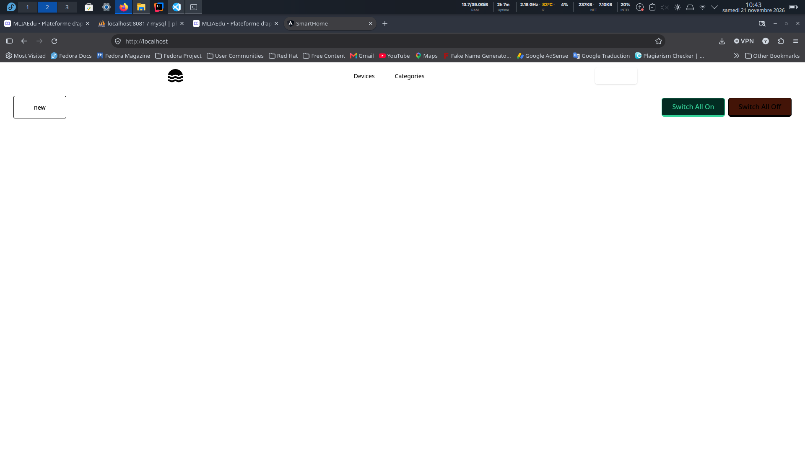
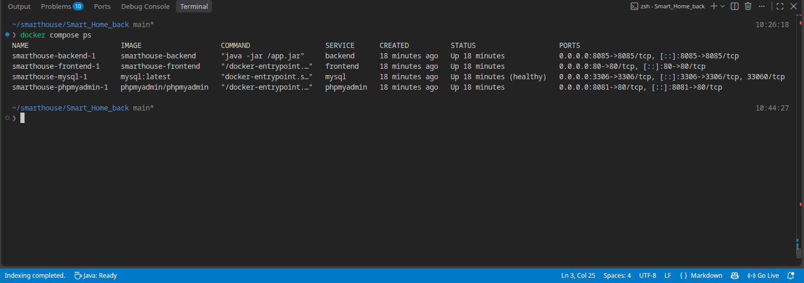
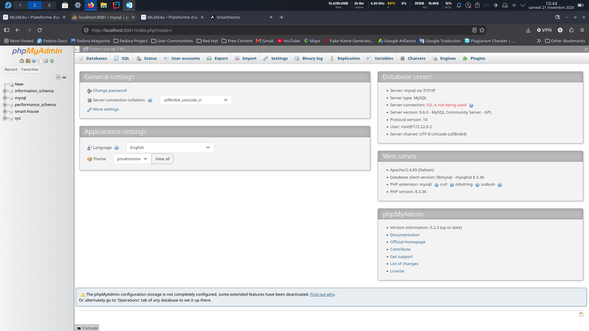

# Smart House

This project provides a containerized smart-home application with an Angular frontend, a Spring Boot backend, MySQL, and phpMyAdmin. Docker Compose now builds the backend JAR in a Maven stage and starts MySQL with a health check before the backend service.

## Running Application

The frontend is available at `http://localhost` and includes controls for devices and the option to switch all devices on or off.

## Docker Services

`docker compose ps` confirms that the frontend, backend, MySQL, and phpMyAdmin containers are running. MySQL is healthy and exposes its database port for local access.

## Database Administration

The phpMyAdmin interface is available at `http://localhost:8081`. It is connected to the `smart-house` MySQL database and shows the server, web-server, and phpMyAdmin configuration details.

